# ResoPon — Upload Your Avatar to Resonite in One Shot!

A tool that makes uploading avatars to Resonite super easy!

Supports VRChat avatar Unitypackages and Prefabs, as well as VRM files. You don't have to use VRoid!

[日本語のドキュメントはこちらです。](ja.md)

This guide describes the current workflow. The equipped avatar photo and expression screenshots show Shipilka. The other screenshots are from the initial version, so labels and layouts may differ from the current app.

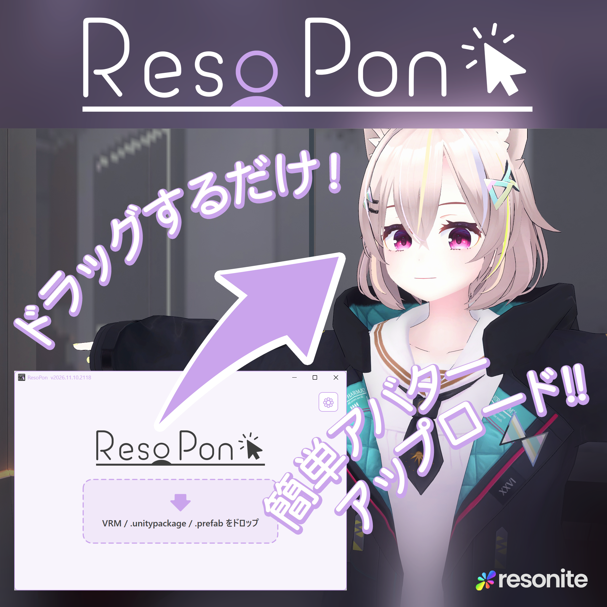

## ✨️Setup

You need Windows x64 and **.NET 10 Desktop Runtime (x64)**.

Install [Resonite](https://store.steampowered.com/app/2519830/Resonite/?l=japanese) and launch it at least once.

Please download ResoPon from [Booth](https://orange3134.booth.pm/items/8515694) or the [GitHub releases](https://github.com/orange3134/VRMtoResonitePackage/releases).

If Resonite isn't detected automatically, open the gear icon in ResoPon and set the "Resonite folder."

## 🔰Getting Started

Launch ResoPon.exe.

(On first launch, you may be asked to allow network access because ResoPon starts Resonite's engine during conversion.)

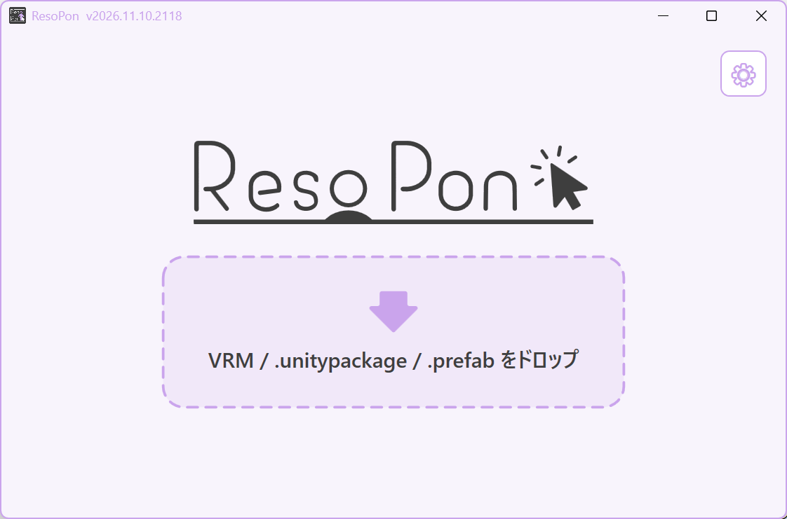

Drag the avatar file you want to upload onto the ResoPon window. Unitypackage, Prefab, and VRM files are supported.

- VRM 0.x and 1.0 are supported.
- If a `.unitypackage` contains multiple avatars, select the one you want to convert.
- Select a `.prefab` inside its original Unity project. A Prefab copied out on its own won't work. You don't need to launch Unity Editor, but the related assets and required packages must be resolvable within the project. ResoPon does not run Modular Avatar / NDMF builds.

Conversion starts. The time required depends on your avatar and PC.
The resulting `.resonitepackage` is saved next to the input file by default. To change this, open the gear icon and set the "Output folder."

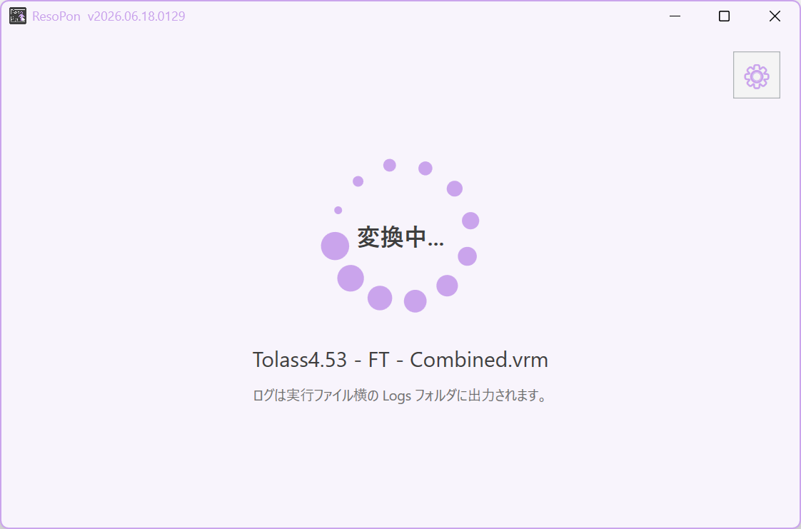

Once conversion finishes, launch Resonite, enter a world, and drag the icon on screen into the Resonite window.

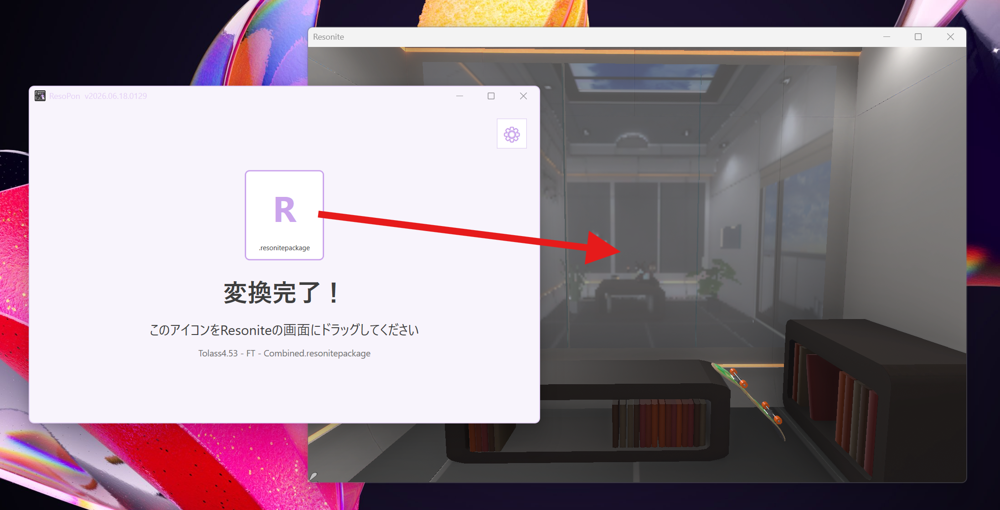

Your avatar shows up!

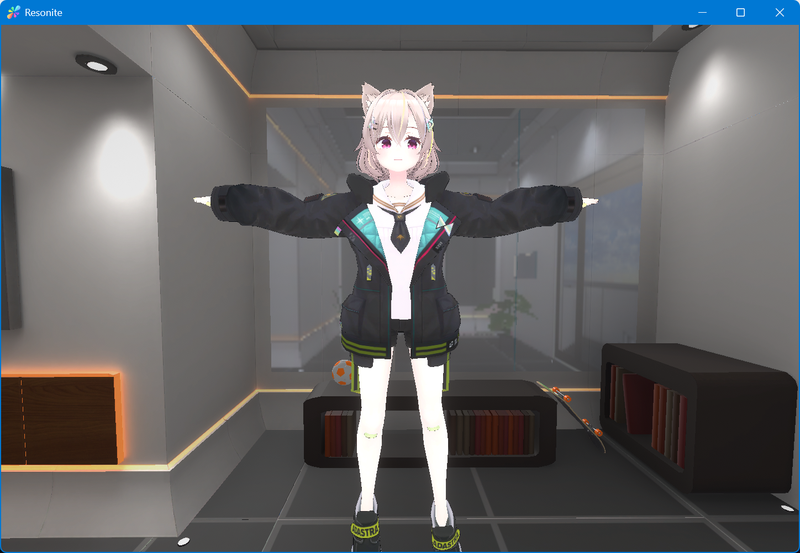

Click the avatar and choose "Equip Avatar."

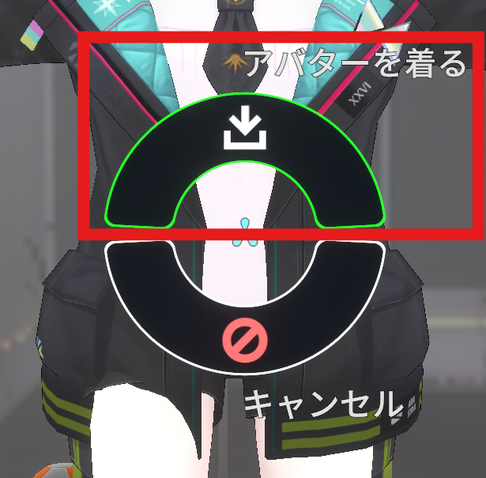

It's on!

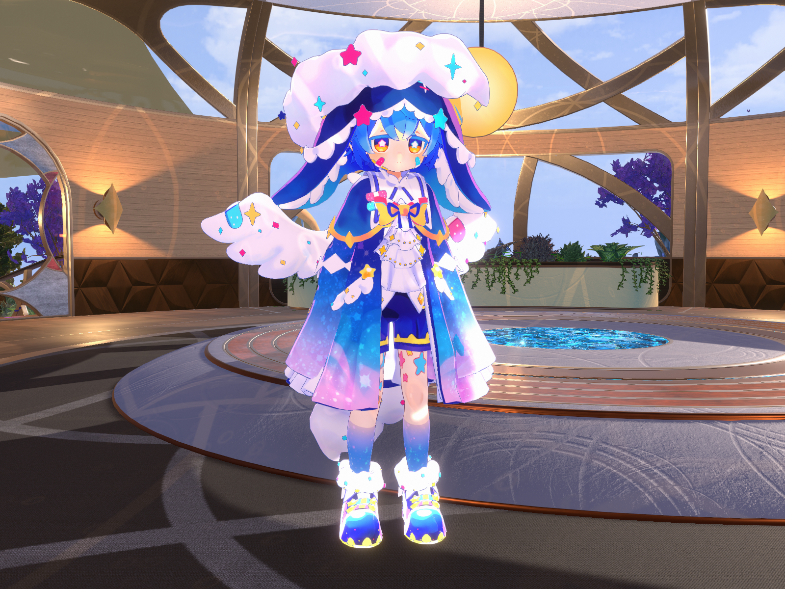

Open your inventory and use "Save Current Avatar" to keep it.

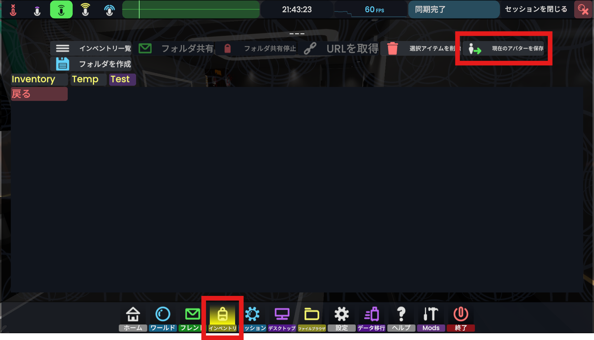

Enjoy Resonite with your favorite avatar!

## ☺️Changing Expressions

Equip the avatar and open the context menu.
(Quest: B/Y button　Index: B button　Desktop: mouse wheel button)

Press `Expressions` → `Select expression`.

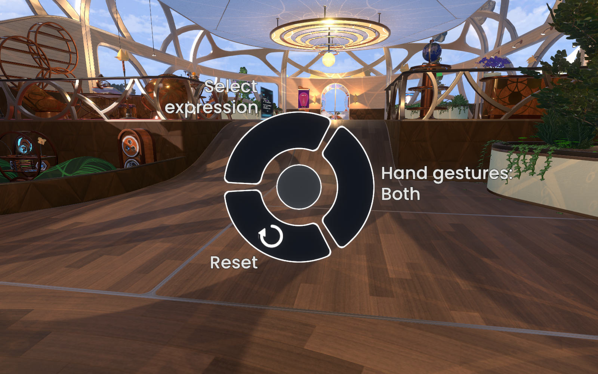

Tap the expression you want to switch to. If there are nine or more, choose from `Group 1`, `Group 2`, and so on.
Your selection stays active. Tap the same expression again or use `Reset` under `Expressions` to release it.
The example below shows Shipilka's `Group 1`. Expression names and counts depend on the avatar.

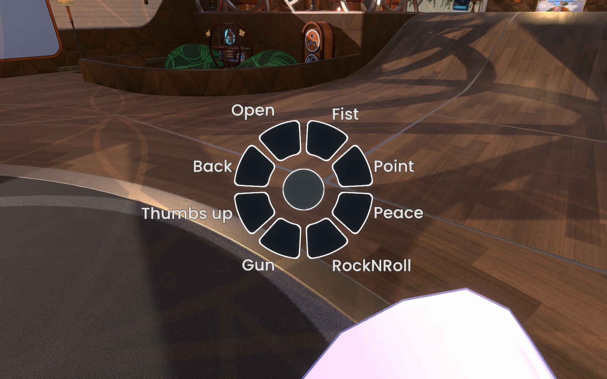

### Hand gestures and keyboard controls

Under `Expressions`, use `Hand gestures` to choose `Both hands enabled`, `Left hand only`, `Right hand only`, or `Both hands disabled`.
The current state is shown as `Hand gestures: Both / LeftOnly / RightOnly / None`.

On the keyboard, `Shift + numpad 0–7` controls the left hand, `Ctrl + numpad 0–7` controls the right, and `Ctrl + Shift + numpad 0–7` controls both.
The standard VRM assignments are 3 for sadness, 4 for joy, 5 for anger, 6 for surprise, and 7 for relaxation. Missing expressions are left unassigned.
VRChat avatars use the original assignments that ResoPon can import.

Hand gestures and keyboard controls won't override a selection held by the menu. Use `Reset` first if the expression won't change.

## ⚠Notes

Please carefully review the usage terms and license info of the avatar and assets you're using, along with Resonite's Terms of Use and EULA, and follow the rules.

Resonite policies
[https://resonite.com/policies/index.html](https://resonite.com/policies/index.html)

## ❓️Q&A

### Is the uploaded avatar private to me? (Can other people save it?)

Avatar protection is enabled by default. Ownership is assigned to the user who imports the package into Resonite.
Protection restricts normal saving and use by other users.

You can also make it usable by anyone by choosing "Do not add avatar protection" from the gear icon in the app.

### I want to use the avatar at its original size (so it doesn't get huge when I reset scale after equipping)

Turn on "Keep the avatar's original scale" from the gear icon in the app, then convert.

### Parts of my avatar glow in dark areas

Semi-transparent materials (MToon's AlphaMode set to Transparent) get converted this way.

Because of how XiexeToon works, it's hard to have both semi-transparency and shadow reception at once, so semi-transparency is prioritized.

You can choose how this is handled during conversion by turning on the following setting from the gear icon in the app.

The setting is "Choose how to convert transparent materials." If the VRM has applicable materials, you can select `Alpha` or `Cutout` for each before conversion. This dialog is not shown for unitypackage / prefab files.

Cutout blends more naturally with lighting. (In exchange, transparency becomes binary — fully transparent or fully opaque.)

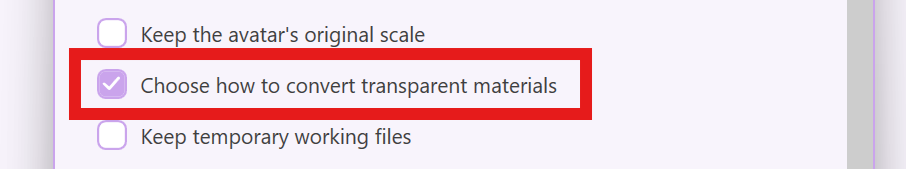

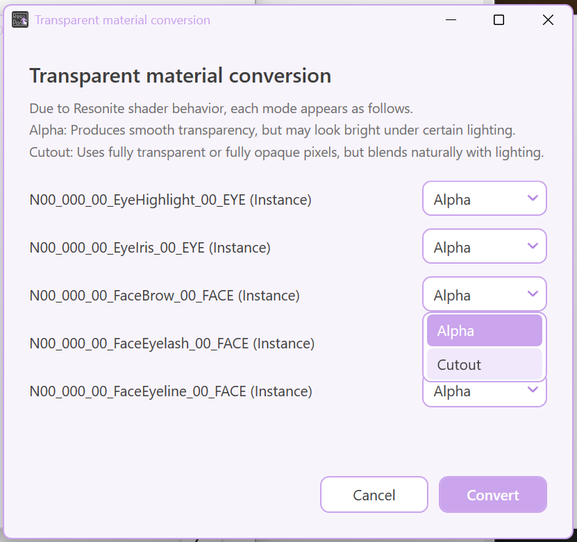

### Conversion failed / it converted but doesn't work right in Resonite

Please post the following in the [ResoPon thread](https://discord.com/channels/1155744905604366489/1514226522813239346) on the [Resonite Japan Discord](https://discord.gg/pvjt2BDMRG).

- The avatar's name, file format, and steps to reproduce the problem
- What isn't working
- Your ResoPon and Resonite versions
- The log file (`Logs/convert_*.log`, next to ResoPon.exe)

Use "Open log folder" at the bottom of Settings or on the conversion failure screen to find the log.
If conversion stopped working after a Resonite update, check for a compatible ResoPon release.

### How do I upload a face-tracking-compatible avatar?

Turn on "Generate face-tracking drivers" from the gear icon in the app.

The avatar needs shape keys that meet Resonite's face-tracking requirements.

### Do you support custom Expressions?

Yes. VRM custom expressions with importable facial blendshapes are also kept in the menu. You can select them even if they have no standard hand gesture assignment.
The VRM0.x custom expression `Surprised` also receives the standard surprise assignment.

For VRChat avatars, ResoPon imports facial expressions from the first expression set it can detect. It doesn't reproduce the entire original Expression Menu or arbitrary features such as outfit switching.

### There's no Expressions button in the context menu

Check that "Do not generate an expression menu" and "Skip avatar setup" are off in the gear settings, then convert and import the avatar again.
The menu is also omitted if there are no importable facial expressions.

"Do not generate an expression menu" only omits the menu. Hand gestures, keyboard expression controls, lip sync, and blinking remain available.

### How do I change the language or update checks?

Use "Language" and "Check for updates when the app starts" in the gear settings.
When an update is found, a confirmation dialog appears. Accepting it downloads the update, replaces the executable, and restarts the app.

## License

MIT license

## Special Thanks

Contributors

yoshi1123_

Claude Fable 5

Claude Opus 4.8

ChatGPT GPT5.5

Logo

YOUR

Everyone who joined the testing

All the avatar creators
