# ResoPon アバターを一発でResoniteにアップロード！

アバターを超簡単にResoniteにアップロードできるツールです。

VRChat向けアバターのUnitypackageとPrefab、またはVRMに対応！（VRoidじゃなくても使えます！）

[The English documentation is available here.](en.md)

このガイドは現行の操作に合わせています。表情画面はトラスで撮影しています。その他の画像は初期版のため、現在の画面と項目名・配置が異なる場合があります。

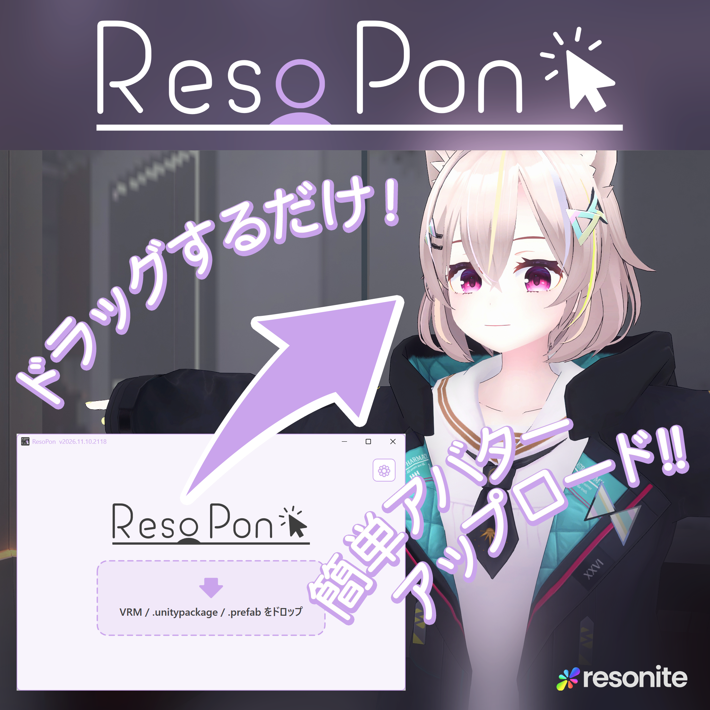

## ✨️準備

[Resonite](https://store.steampowered.com/app/2519830/Resonite/?l=japanese)をインストールし、一度は起動しておいてください。

[Booth](https://orange3134.booth.pm/items/8515694)または[GitHub Releases](https://github.com/orange3134/VRMtoResonitePackage/releases)からResoPonをダウンロードしてください。

Resoniteが自動検出されない場合は、ResoPonの歯車アイコンから「Resoniteフォルダ」を指定してください。

## 🔰使ってみる

ResoPon.exeを起動してください。

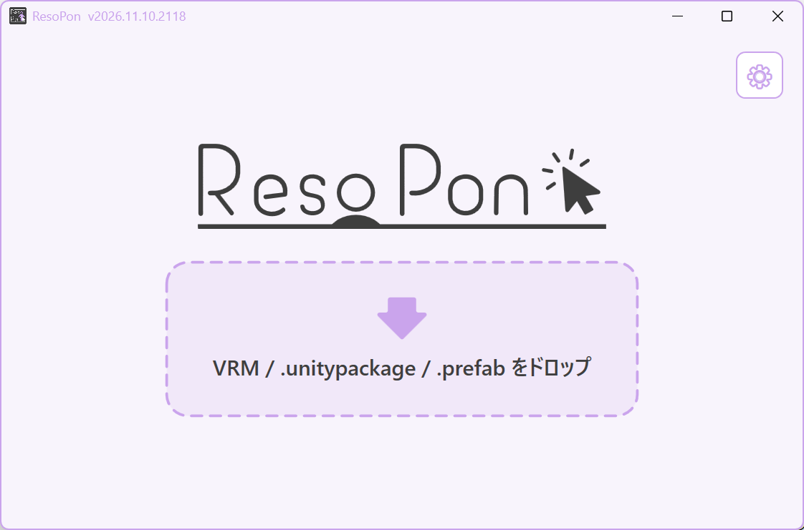

（初回起動時にネットワークの許可を求められる場合があります。変換中にResoniteのエンジンを起動するためです。）

ResoPonの画面にアップロードしたいアバターファイル（Unitypackage、Prefab、VRMに対応）をドラッグしてください。

- VRMは0.x / 1.0に対応しています。
- `.unitypackage` に複数のアバターがある場合は、変換する対象を選んでください。
- `.prefab` は元のUnityプロジェクト内にあるファイルを指定してください。Prefabだけを別の場所へコピーしたものは使えません。Unity Editorの起動は不要ですが、関連アセットと必要なパッケージがプロジェクト内で解決できる必要があります。Modular Avatar / NDMFのビルド処理は実行しません。

変換が始まります。所要時間はアバターの複雑さやPCによって異なります。
出力される `.resonitepackage` は、初期設定では入力ファイルと同じフォルダに保存されます。変更する場合は歯車アイコンから「出力先フォルダ」を指定してください。

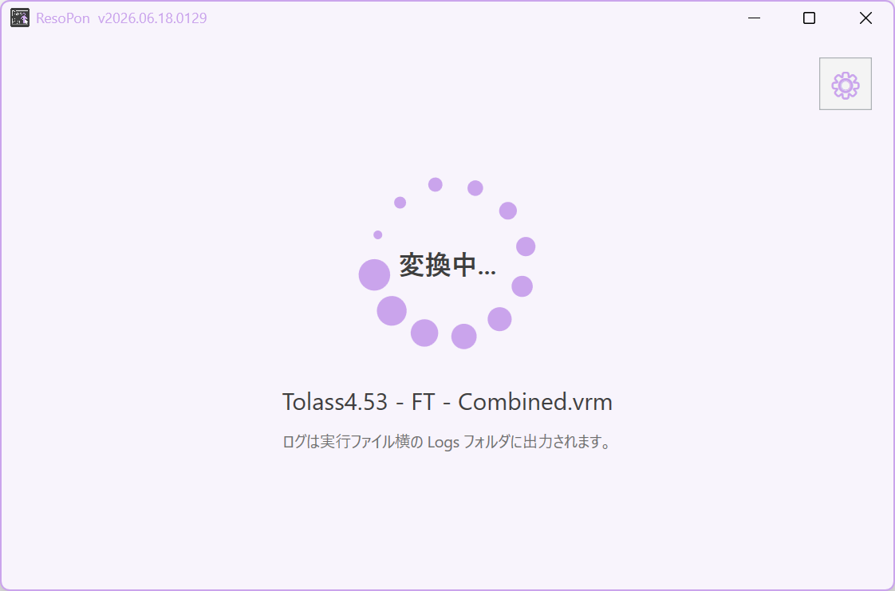

変換完了したら、Resoniteを起動してワールドに入り、画面上のアイコンをResoniteの画面にドラッグしてください。

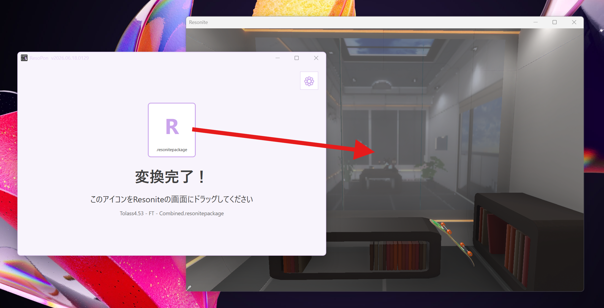

アバターが出てきました！

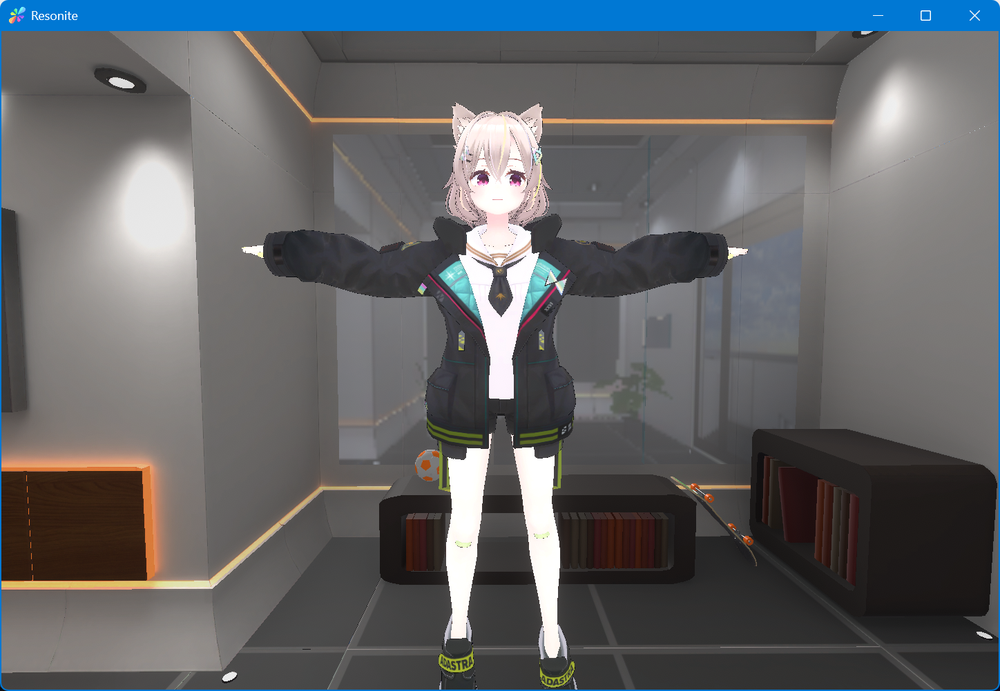

アバターをクリックして「アバターを着る」

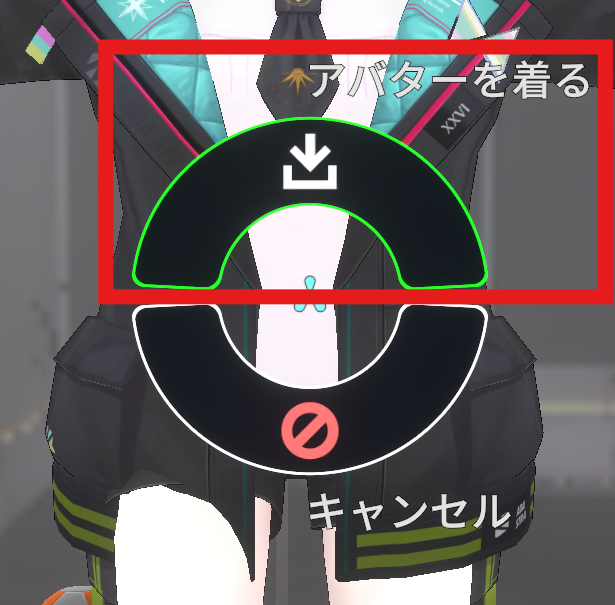

うまく着られました！ インベントリを開いて「現在のアバターを保存」しておきましょう。

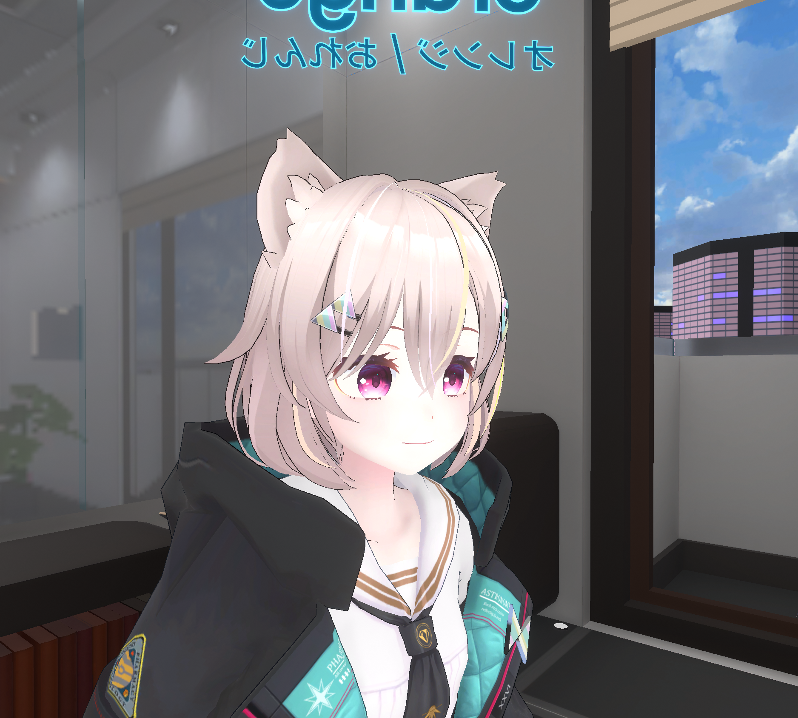

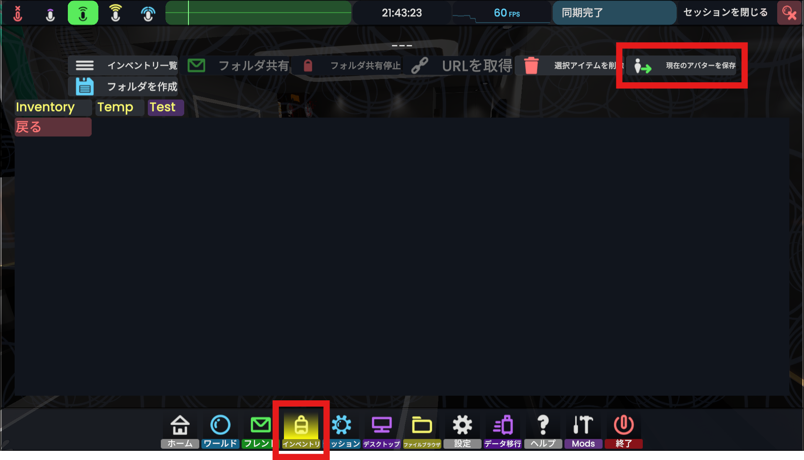

お気に入りのアバターでResoniteをお楽しみください！

## ☺️表情を変える

アバターを着た状態でコンテキストメニューを開いてください。
（Quest：B/Yボタン　Index：Bボタン　デスクトップ：マウスホイールボタン）

`Expressions` → `Select expression` を押してください。

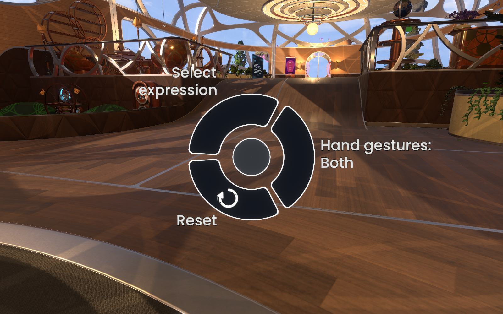

変えたい表情を押してください。表情が9個以上ある場合は `Group 1`、`Group 2` などから選びます。
選んだ表情は保持されます。同じ表情をもう一度押すか、`Expressions` の `Reset` で解除できます。
以下はトラスの `Group 1` の例です。表情の名前・数はアバターによって異なります。

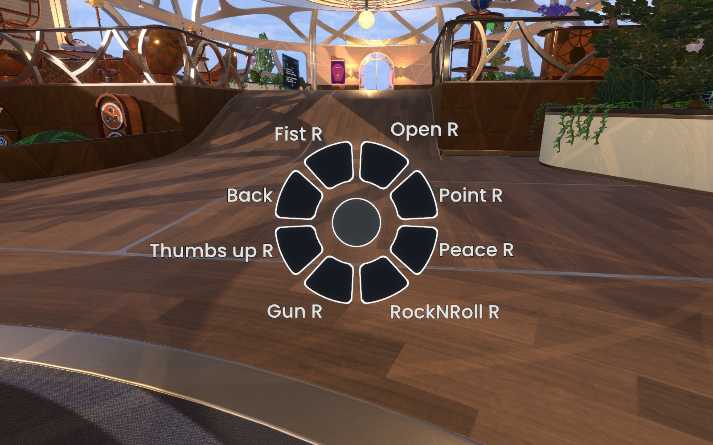

### キーボードで操作する

`Shift + テンキー0～7` が左手に設定された表情、`Ctrl + テンキー0～7` が右手に設定された表情を変更できます。

テンキーの番号は、次のハンドサインに対応します。

| 番号 | ハンドサイン |
|---|---|
| 0 | Neutral |
| 1 | Fist |
| 2 | HandOpen |
| 3 | FingerPoint |
| 4 | Victory |
| 5 | RockNRoll |
| 6 | HandGun |
| 7 | ThumbsUp |

VRMの標準割り当ては、3が悲しみ、4が喜び、5が怒り、6が驚き、7がリラックスです。

## ⚠注意

ご使用になるアバター・素材の使用許諾・ライセンス情報とResoniteのTerms of Use・EULAをよくご確認の上、ルールを守ってご使用ください。

Resonite ポリシー
[https://resonite.com/policies/index.html](https://resonite.com/policies/index.html)

## ❓️Q&A

### アップロードしたアバターは自分専用になっていますか？（他人に保存されたりしませんか？）

初期設定で自分専用・他人に保存できない状態になっています。

アプリの歯車アイコンから「アバター保護を付けない」で誰でも利用できるように変更することも可能です。

### アバターを原寸サイズで使いたい（着た後スケールリセットしてもデカくならないようにしたい）

アプリの歯車アイコンから「アバターの原寸サイズを維持」をオンにして変換してください。

### アバターの一部が暗いところで光って見えます

半透明になっている（MToonのAlphaModeがTransparent）マテリアルがそのように変換されます。

XiexeToonの仕様上半透明の表示と影を受け取る処理を両立することが難しいため、半透明を優先しています。

アプリの歯車アイコンから、以下の設定をオンにすることで変換時に処理を選ぶことができます。

設定名は「半透明マテリアルの変換先を手動で選ぶ」です。VRMの対象マテリアルがある場合、変換前に材質ごとに `Alpha` / `Cutout` を選べます。

Cutoutを選べば、光らなくなります。（代わりに透明度は透明か不透明かの2値になります）

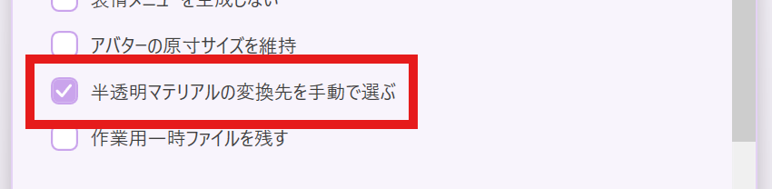

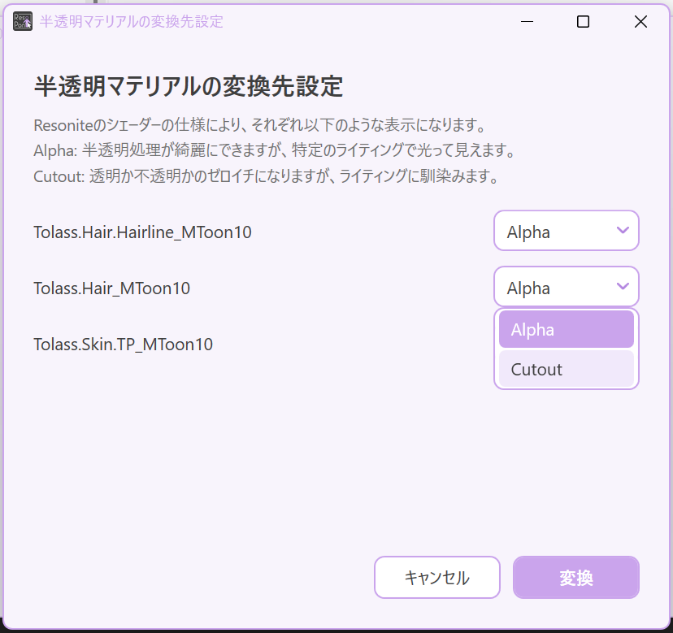

### 変換失敗しました/変換できたけどResonite上でうまく動きません

[Resonite Japan Discord](https://discord.gg/pvjt2BDMRG)の[ResoPonスレッド](https://discord.com/channels/1155744905604366489/1514226522813239346)に以下の内容をお知らせください。

- 変換しようとしたアバター
- どこがうまく動いていないか
- ログファイル（ResoPonと同じフォルダにあるLogフォルダ内にあります）

設定画面の下部、または変換失敗画面の「ログフォルダを開く」からログを確認できます。

### フェイストラッキング対応アバターをアップロードするには？

アプリの歯車アイコンから「フェイストラッキング用ドライバーを生成」をオンにしてください。

アバターがResoniteのフェイストラッキング要件に合ったシェイプキーを持っている必要があります。

### コンテキストメニューにExpressionsボタンがありません

歯車アイコンの「表情メニューを生成しない」と「アバターセットアップを行わない」がオフになっているか確認し、再変換・再インポートしてください。
取り込める顔の表情がない場合もメニューは生成されません。

「表情メニューを生成しない」はメニューだけを省略します。ハンドサイン・キーボードでの表情操作は引き続き利用できます。

## ライセンス

MIT license

## スペシャルサンクス

コントリビューター

yoshi1123\_さん

claude Fable 5ちゃん

claude Opus4.8ちゃん

ChatGPT GPT5.5ちゃん

ロゴ作成

YOURさん

テストに参加いただいたみなさま

アバター作者のみなさま
